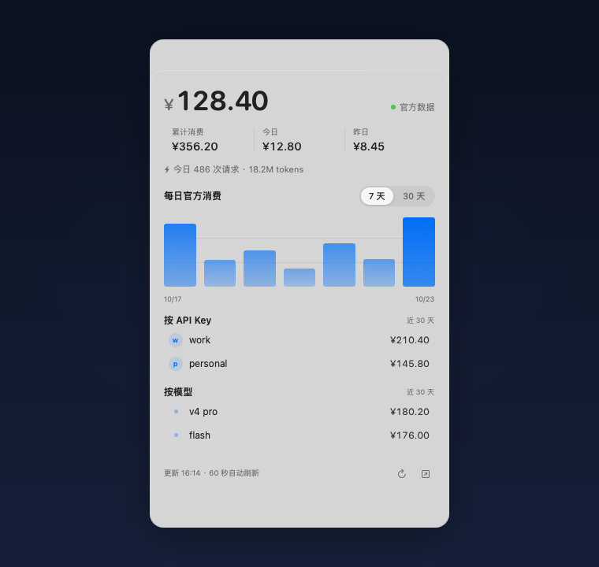

# DeepSeek 账单

[](https://github.com/Robfat/deepseek-bill/actions/workflows/build.yml)

macOS 菜单栏小工具：在桌面层常驻显示 **DeepSeek 官方余额** 与 **官方消费**。



不是本地 token 估算——余额和消费都直接来自 DeepSeek 开放平台接口。

## 功能

- **官方余额**：平台账户余额（赠送/充值拆分在平台侧）
- **官方消费**：累计消费、今日、昨日，逐日 30 天趋势
- **按 API Key 拆分**：每个 Key 近 30 天花了多少
- **按模型拆分**：flash / pro / vision 等模型的花费
- **今日请求数与 tokens**
- 毛玻璃窗口，**桌面层挂件**：只在桌面显示，被其他应用窗口盖住，不会浮到窗口前面；点菜单栏图标显示/隐藏
- 菜单栏显示 `¥余额`，左键开合，右键：刷新 / 平台用量页 / 退出
- 7 天 / 30 天趋势切换，悬停柱子看当天金额
- 每 60 秒自动刷新，深浅色自适应，拖动后记住位置，跨桌面空间显示

## 数据来源

| 数据 | 官方接口 |
| --- | --- |
| 余额、累计消费 | `GET https://platform.deepseek.com/api/v0/users/get_user_summary` |
| 逐日 / 分 Key / 分模型消费 | `GET https://platform.deepseek.com/api/v0/usage/by_api_key/cost` |
| 今日请求数 / tokens | `GET https://platform.deepseek.com/api/v0/usage/by_api_key/amount` |
| 余额兜底 | `GET https://api.deepseek.com/user/balance` |

> `/api/v0/usage/*` 是平台用量页使用的私有接口，需要网页登录态 `userToken`；接口可能随平台调整而变化。
> 本项目与深度求索没有任何隶属或背书关系。

## 系统要求

- macOS 13 或更高
- Apple Silicon（arm64）
- Xcode Command Line Tools（`xcode-select --install`）

## 构建

```bash
git clone https://github.com/<your-name>/deepseek-bill.git
cd deepseek-bill
./build.sh
open DeepSeekBill.app
```

构建产物是一个 ad-hoc 签名的 `.app`。首次打开若被 Gatekeeper 拦截，右键 →「打开」。

## 配置

首次运行前，把凭据写到：

```
~/Library/Application Support/DeepSeekBill/config.json
```

```json
{
  "apiKey": "sk-...",
  "platformToken": "..."
}
```

权限建议 `600`。

- `apiKey`：DeepSeek 开放平台 API Key，用于余额兜底
- `platformToken`：`platform.deepseek.com` 的登录态 `userToken`，官方消费/用量必需
  - 获取方式：登录 [platform.deepseek.com](https://platform.deepseek.com)，打开开发者工具 Console，执行：
    ```js
    JSON.parse(localStorage.getItem('userToken')).value
    ```

没有 `platformToken` 时应用仍可显示余额，消费部分会空着。

## 隐私

- 凭据只保存在本机配置文件，不写入日志、不上传
- 网络请求只发往 `api.deepseek.com` 与 `platform.deepseek.com`

## 已知限制

- 平台 `userToken` 会过期；过期后面板提示重新获取
- 未做 Apple 开发者签名与公证，首次运行需要手动放行
- 仅构建 arm64，Intel Mac 需要自行改 `-target`

## 免责声明

本项目为个人使用的第三方工具，不是 DeepSeek 官方产品。请自行确认平台接口的使用条款与风险。

## License

[MIT](LICENSE)

---

## English

**DeepSeek Bill** is a tiny macOS menu bar app that shows your **official DeepSeek account balance and spend** on the desktop.

It reads the official platform endpoints (balance, `get_user_summary`, `usage/by_api_key/cost`) — no local token estimation. The glass panel sits at desktop level (behind normal windows), stays there until you toggle it from the menu bar, and refreshes every 60 seconds.

Requirements: macOS 13+, Apple Silicon, Xcode Command Line Tools. Build with `./build.sh`. Credentials live in `~/Library/Application Support/DeepSeekBill/config.json`.

Not affiliated with DeepSeek. MIT licensed.
